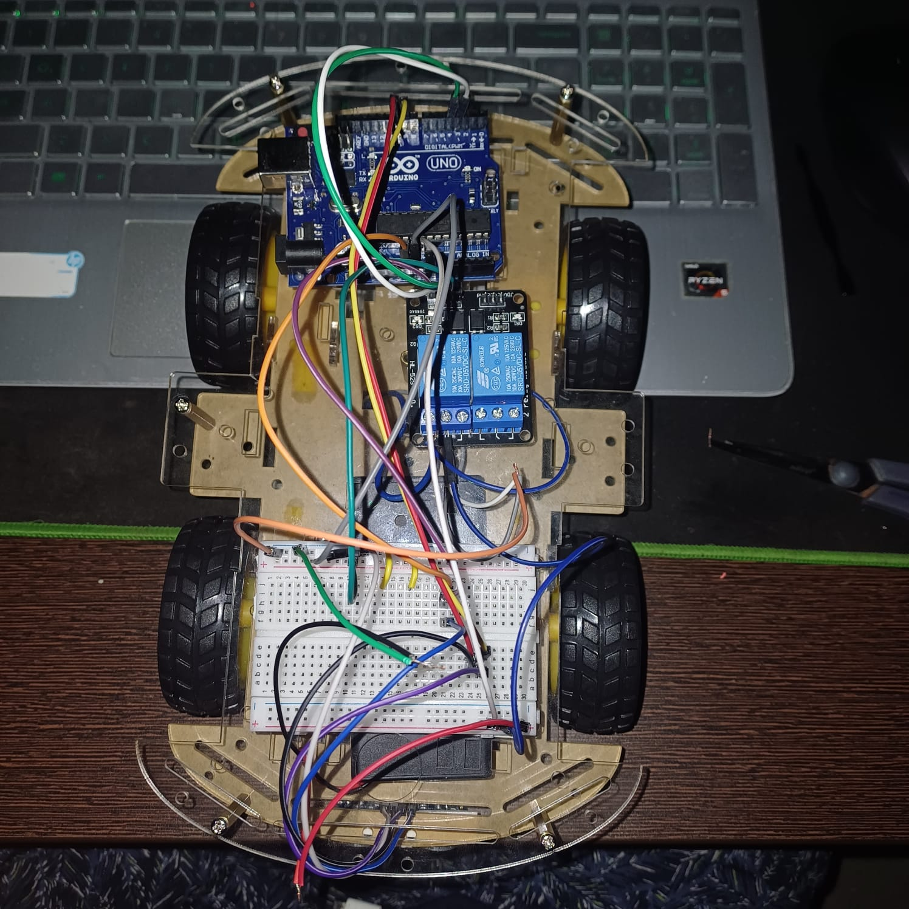

# Smart Advanced Railway Safety System

An Arduino-based model vehicle prototype that uses ultrasonic sensing to detect an obstacle and trigger a stop response.



## Project overview

This team project explores an automatic obstacle-response system for a model railway vehicle. The project report describes an Arduino Uno reading an HC-SR04 ultrasonic sensor, stopping the vehicle when an obstacle is within a defined threshold, illuminating an LED, and transmitting a stop signal to a receiver.

This is an educational model-scale prototype, not a validated railway or road safety system.

## Features

- Ultrasonic distance sensing with an HC-SR04
- Arduino Uno-based monitoring and control
- Motor stop response when an obstacle is detected
- LED indication and transmitted stop signal, as described in the report
- Battery-powered model vehicle

## Hardware

| Component | Role described in the report |
| --- | --- |
| Arduino Uno | Reads the sensor and controls the response |
| HC-SR04 ultrasonic sensor | Measures distance to an obstacle |
| Gear motors and wheels | Move the model vehicle |
| Relay module / motor control | Switches or controls vehicle movement |
| LED | Provides a visual stop indication |
| Transmitter and receiver | Communicate the stop signal |
| Batteries, breadboard and jumper wires | Power and prototype connections |

The report refers to both a relay module and a motor driver. The exact wiring and implementation should be checked against the actual hardware before reproducing the project.

## How it works

```text
Obstacle → Ultrasonic sensor → Arduino Uno → Motor stop
                                    ├──────→ LED indication
                                    └──────→ Transmitter → Receiver
```

The report describes a threshold of approximately 10 cm during its demonstration. This is a reported test setting, not an independently verified performance specification. Response time and detection reliability have not been independently verified for this repository.

## Repository contents

```text
Images/    Prototype photograph
Docs/      Original project report
```

[Read the project report](Docs/Project-Report.docx)

The report contains circuit diagrams and a code section. No separate, runnable source code was supplied for this repository.

**Project guide:** Prof. Dr. Mohan Allam, VIT-AP University

## Skills demonstrated

Embedded systems, Arduino programming, ultrasonic sensing, motor control, prototyping, and hardware integration.

